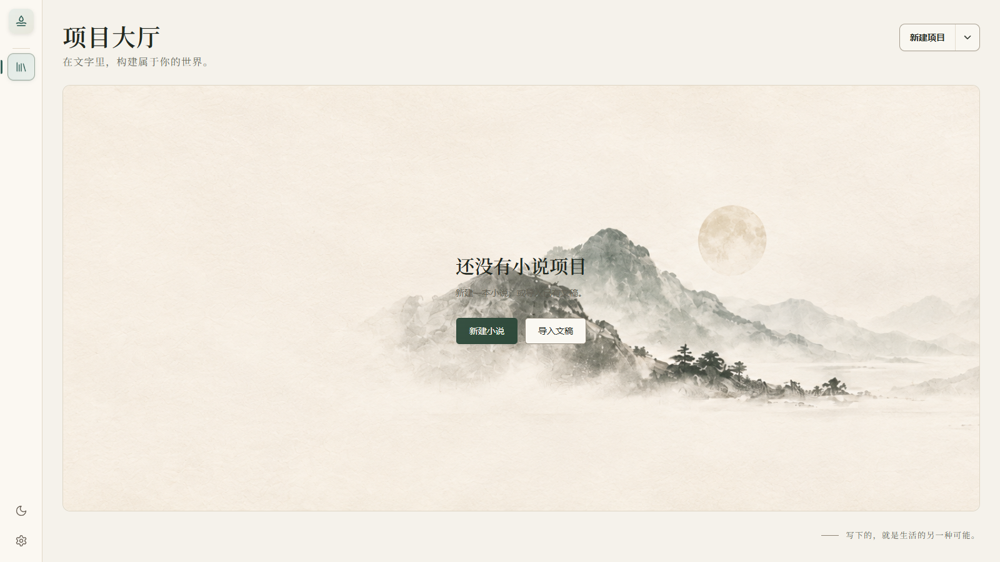
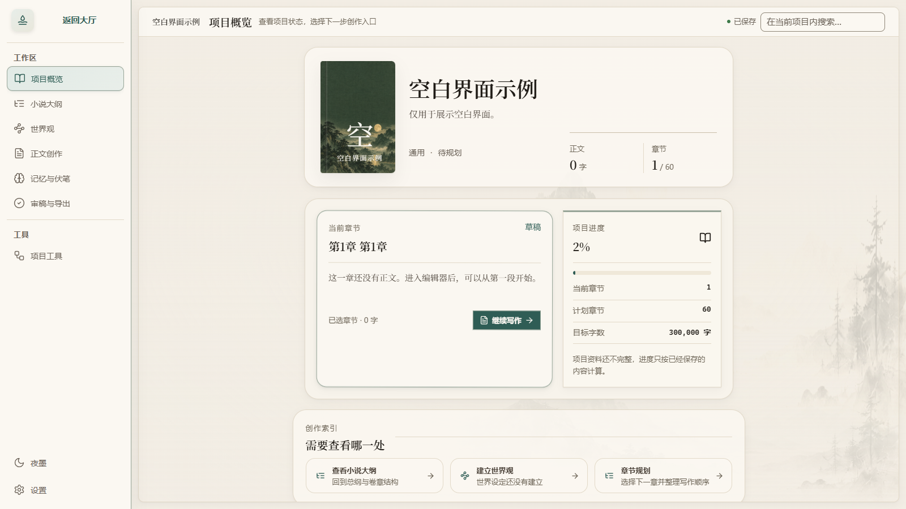
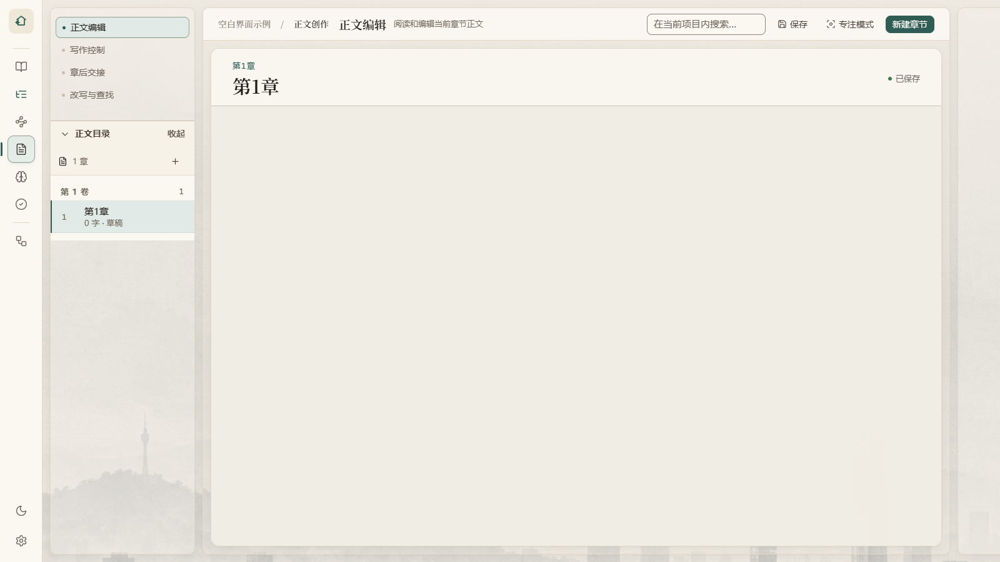

# 墨境

写一部长篇，故事会越来越大。新人物出现，旧伏笔要回收，前几章定下的规则还得在后面说得通。墨境把正文和这些资料放在同一个本地项目中，让作者写作时能够随时回看、整理和检查。

墨境是一款面向 Windows 11 的小说创作软件。可以只用它手写，也可以接入自己选择的模型服务，让 AI 提供大纲、设定或正文候选。候选由你决定是否采用；已经写下的正文不会因一次普通生成而被悄悄替换。

[下载墨境 1.0.0](https://github.com/Kaktus981/mojing/releases/download/v1.0.0/Mojing_1.0.0_x64_Setup.exe) · [看空白项目界面](#空白项目长什么样) · [安装与版本说明](#安装与版本说明)

## 一本小说在这里怎样推进

1. **先留下故事起点。** 新建项目后记录想写的故事，再选择通用、玄幻修仙、科幻、历史架空、都市或悬疑模板作为起点；模板不会替你决定情节。
2. **把资料放回各自的位置。** 世界观保存人物、地点、势力与规则；大纲整理全书方向、卷章安排和故事线。要改设定时，可以直接找到它。
3. **按章节写正文。** 左侧目录负责切章，中间编辑区留给文字；字数、专注模式、查找替换和保存状态在需要时可用。没有配置模型也能完成这一步。
4. **回看前文留下的线索。** 记忆与伏笔栏目记录角色状态、关系、剧情事实及伏笔进展。审稿时再查看连续性问题和修改建议，由作者决定怎样处理。
5. **带走作品。** 可以导出 TXT、Markdown、DOCX 文稿，也可以导出完整项目备份；版本历史用于查看检查点及恢复旧版本。

### AI 建议如何进入作品

墨境会依据当前项目资料组织生成任务，并把结果放在候选中。你可以先阅读、调整或拒绝，再明确采用需要的内容。模型服务由你在设置中自行配置；普通离线写作不依赖它。

## 空白项目长什么样

下面三张图来自专门创建的空白示例项目，没有使用作者作品。







## 安装与版本说明

墨境 1.0.0 只支持 Windows 11 64 位。从本仓库的 [v1.0.0 发布页](https://github.com/Kaktus981/mojing/releases/tag/v1.0.0)下载 `Mojing_1.0.0_x64_Setup.exe`；GitHub 页面上自动生成的 Source code 压缩包是源码，不是安装程序。安装包已包含运行所需的应用，不必为使用软件另装 Node.js。

安装器只为当前 Windows 用户安装，可选择安装位置；完成时可以决定是否打开墨境、是否创建桌面快捷方式。安装包尚未进行代码签名，Windows 可能显示“未知发布者”。请核对下载来源；该文件的 SHA-256 是 `FE311DE2AD4133F04D3444AD0164029FEC4C3EEFA1A46BAC6013A6B3D011C517`。

软件内尚无正式在线更新来源，后续版本需要从 Releases 手动下载。真实跨版本升级及失败回退流程还未完成系统级验收；升级前请先导出完整项目备份。

## 作品留在你的电脑上

项目、章节、版本记录和设置默认保存在本机。只写作时不需要把作品发送给墨境维护者；主动使用 AI 功能时，该次任务需要的上下文会发往你在设置中填写的模型服务地址。服务商怎样处理这些内容，取决于其自身规则，详见[隐私说明](PRIVACY.md)。

卸载时默认保留作品和设置。只有在卸载向导里主动选择删除，并再次确认后，安装器才会尝试清除相关本机数据。重要作品建议定期导出完整项目备份，另存到你管理的位置。

## 想查看或运行源码

仓库把界面、本机服务、桌面外壳和数据处理分别放在 `apps/web`、`apps/api`、`apps/desktop` 与 `packages`。开发环境建议使用 Windows 11 64 位和 Node.js 22；在仓库根目录运行：

```powershell
npm install
npm run dev
```

浏览器开发环境默认打开 `http://localhost:5173`，开发数据与桌面版作品数据分开。修改代码后可运行 `npm run typecheck`、`npm test` 和 `npm run build`；端到端测试通过 `npm run test:e2e` 使用隔离的内存数据库。更具体的步骤分别写在[开发说明](docs/DEVELOPMENT.md)、[架构说明](docs/ARCHITECTURE.md)和[安装包构建说明](docs/BUILDING.md)中；工作区功能与接口见[功能说明](docs/墨境-1.0-功能与开发说明.md)。

## 软件许可和作品归属

墨境自有代码以 [GNU AGPL v3.0 only](LICENSE) 开源，第三方组件适用各自许可证。软件的开源许可不会自动套用到你写的小说；你保留自己输入和创作的作品权利，墨境不会仅因参与创作而主张所有权、版税或收入分成。详见[作品权利说明](OUTPUT_RIGHTS.md)与[第三方说明](THIRD_PARTY_NOTICES.md)。

公开分发的修改版须更换“墨境”名称和主图标，并说明它不是官方版本；水墨背景可沿用或修改。具体边界见[品牌使用说明](TRADEMARKS.md)。

发现问题或希望增加功能，可以到 [Issues](https://github.com/Kaktus981/mojing/issues) 留言。请勿上传作品正文、模型密钥或数据库；安全漏洞先按[安全报告说明](SECURITY.md)私密报告。公开版本变化记录在 [CHANGELOG](CHANGELOG.md)，贡献规则将在后续补充。

Copyright © 2026 Kaktus981.
